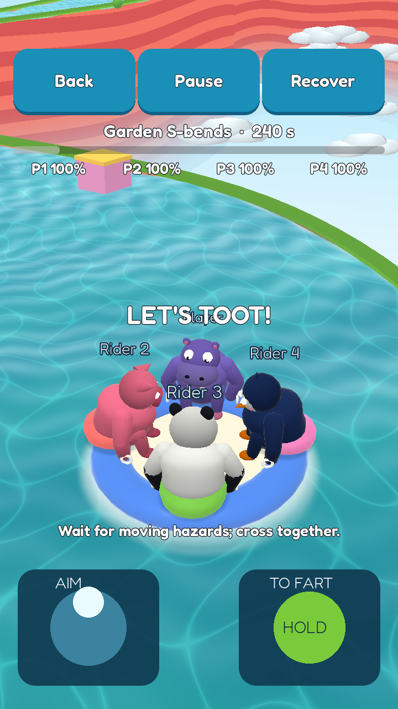
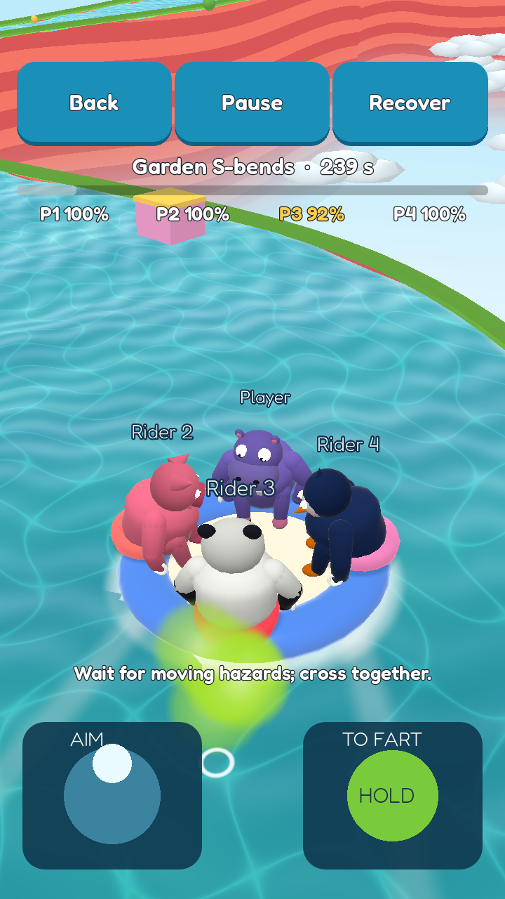

# Toot Tubes – ITSD 85 Lab 5

Team: Cazo – Carlos Fidel G. Castro (solo: design, programming, art, audio, testing)   Section: BSIT-4C   Platform: Android

## About the game
**Toot Tubes** is a cooperative party game where up to four cartoon animals share one
swim ring and steer it through sky-high waterpark courses using nothing but their farts.
Each rider has their own gas; their pushes combine on the same ring, so the crew has to
work together to dodge mallets, crushers and whirlpools before the timer runs out.

| Riders on the ring | One rider farting |
|---|---|
|  |  |

## How to play
- **Left pad (AIM):** choose a direction. Your rider walks around the rim toward it.
- **Right button (HOLD):** hold to fart and push the ring; release to coast.
- Each rider has a **gas meter** that refills while resting; **beans** refill it faster.
- **Goal:** get the whole crew to the finish before the timer ends (the goal is shown at the start of each level).
- **Stars:** more than 50% of the time left = 3 stars, more than 25% = 2, otherwise 1. Falling sends the crew back to the last checkpoint while the clock keeps running.
- **Unlocking:** Level 1 is open. Clear a level to unlock the next; locked levels show a lock. Progress is saved on the phone.
- **Pause:** Resume, Restart, Sound on/off, Quit. Every screen has Back (the Android back gesture also works).

## Offline and online modes
- **Offline (works in airplane mode):** Play → **Play offline**. Add up to three computer assistant riders in Crew Setup, then start a course from Level Select.
- **Online (same Wi-Fi, 2–4 phones):**
  1. Phone 1: Play → **Host a game**. The screen shows its IP (for example `192.168.1.23`).
  2. Phone 2: Play → type that IP → **Join**.
  3. Guests tap Ready, then the host taps **Start together**. Everyone controls their own rider on the same ring.

  The host runs the ring and decides the result. If the host can't be reached within 5 seconds, or anyone disconnects, a message is shown and the game returns to Mode Select. Online results do not change offline unlocks.

## How to build
- Godot **4.7.2 standard** (not .NET), Compatibility renderer. Open `project.godot` and press **F5**.
- Android export:
  1. Install OpenJDK 17 and the Android SDK, then set both paths in Editor Settings → Export → Android.
  2. Install the export templates (Editor → Manage Export Templates).
  3. Project → Export → **Android Release** (package `com.itsd85.cazo.toottubes`, version 1.0) → Export Project with *Export With Debug* off.
  4. Signing uses your own release keystore, which is never committed. `tools/build_phase5.ps1` builds and verifies the debug, release and Windows builds.
- Tests: `bash tools/run_tests.sh` (GUT, headless) and `bash tools/net_smoke.sh` (two- and four-phone LAN simulation).

## Download
**v1.0 release APK:** <link to the GitHub v1.0 release>. Install it on Android 7.0 or later and allow "Install unknown apps".

## Playtest results
*To be filled in after the playtest (see `docs/playtest/`):*
1. Finding 1 → fix → retest result
2. Finding 2 → fix → retest result
3. Finding 3 → fix → retest result

## Credits
All art, models, music and sound effects are original. Font: Fredoka (SIL OFL). Engine: Godot (MIT).
Full list: [docs/CREDITS.md](docs/CREDITS.md).

## Paper
[docs/paper.pdf](docs/paper.pdf)
