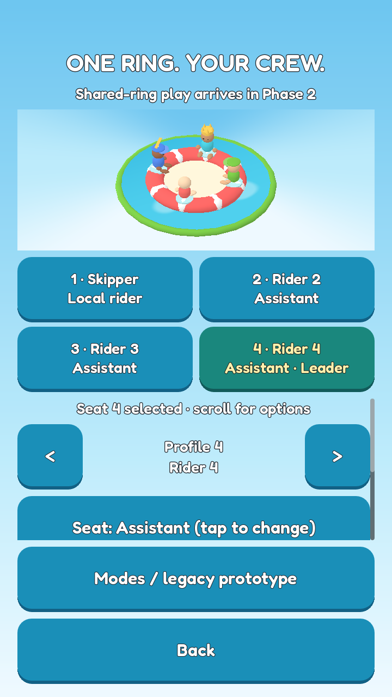

# Revised Phase 1: crew foundation checks

Implemented 2026-11-01. This build previews up to four riders on one ring; shared-ring movement, continuous gas, curved courses and new hazards are Phase 2 work. LAN is Phase 4.

## Run on Windows

From the project folder:

```powershell
& .\.bin\Godot_v4.7.2-stable_win64.exe --path .
```

Or open `project.godot` in the local Godot editor and press F5. The new Android debug build is `export/TootTubes-phase1-crew-debug.apk`. Install over the existing app to retain saves; do not uninstall or clear app data to test migration.

## Gate 1: manual acceptance

- [ ] First use: Tap to start → create/name rider → Save → Main Menu → Play.
- [ ] Select each empty seat. Scroll down to **Seat: Empty**, then tap it to assign an assistant. Four occupied seats show four riders on one ring.
- [ ] Seat mode cycles Empty → Assistant → Local rider → Empty. Empty seats remove their rider. Arrows select an unused profile; a profile cannot occupy two seats.
- [ ] Select a seat → scroll → Edit rider. Change its name, skin, outfit, hat, gas color and ring style. Save changes only that profile. Back cancels unsaved changes. The editor previews that rider's style; Make leader applies it to the crew ring.
- [ ] Make a different occupied seat leader. Confirm the shared ring uses its saved style. Clearing that seat chooses another occupied leader.
- [ ] Close/restart the app. Confirm profiles, seat assignments and leader persist. Existing unlocks, best times/stars and settings remain. The original pre-migration file is retained as `user://save.cfg.pre-v2.bak` after the first save.
- [ ] Check portrait readability, scrolling, 120 px targets and top safe area on the actual phone. Android Back returns Creator → Crew and Crew → Main Menu.
- [ ] Modes / legacy prototype → Play legacy Level 1 still launches the old solo course. Crew selection does not imply multiplayer gameplay in this phase.

## Automated and rendered verification

```powershell
& 'C:\Program Files\Git\bin\bash.exe' tools/run_tests.sh
& .\.bin\Godot_v4.7.2-stable_win64_console.exe --path . --script tools/verify_crew.gd
& .\.bin\Godot_v4.7.2-stable_win64_console.exe --headless --fixed-fps 60 --path . --script tools/verify_level_one.gd
```

GUT uses disposable save paths. `verify_crew.gd` also uses its own disposable save, drives actual button signals and scene transitions, checks 720 × 1280 control bounds/touch sizes, reloads the saved crew, checks Android Back and captures `docs/screenshots/phase1_crew_*.png`. Its headless form checks navigation/layout without screenshots. No real player save is written by these tools.

The four-rider rendered sample is below. Desktop screenshots and counters are not physical-phone performance or touch acceptance.


